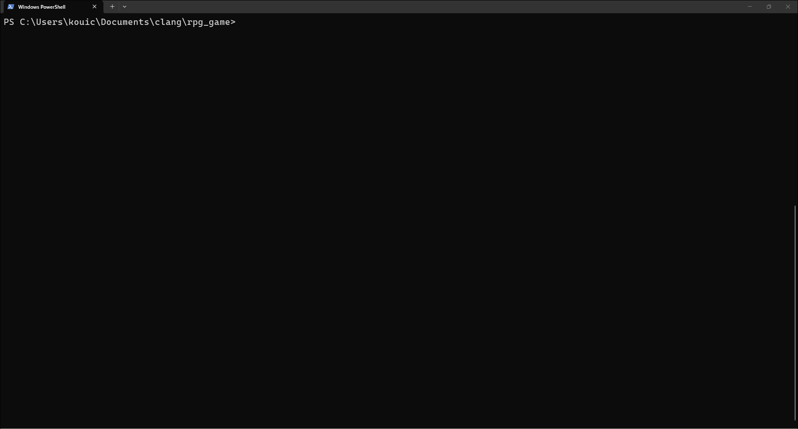
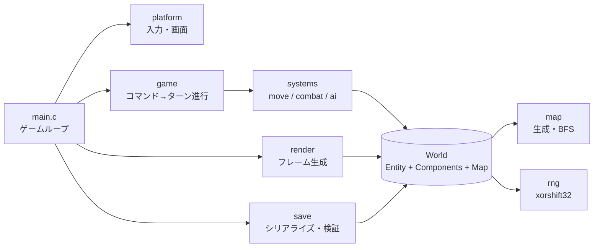

# Console RPG (C / ECS)

[](https://github.com/KoichiKurita/Clang-RPG-Game/actions/workflows/ci.yaml)


C言語（C99）で作成した **ターン制のコンソール型ローグライクRPG** です。
ECS（Entity Component System）設計、検証付きのセーブ形式、ユニットテスト・ファジング・CI まで含めて、
「小さくても実務品質」を目標に作っています。



---

## 🎮 遊び方

ランダム生成されたダンジョンで、ゴール `G` を目指します。敵 `E` は近づくと追いかけてきます。
敵に向かって移動すると攻撃（体当たり攻撃）になります。HP が 0 になるとゲームオーバーです。

| キー | 操作 |
| --- | --- |
| `W` `A` `S` `D` / 矢印キー | 移動・攻撃 |
| `Space` / `.` | その場で待つ |
| `P` | セーブ |
| `Q` | セーブして終了 |

```bash
./rpg              # セーブがあれば続きから
./rpg --seed 42    # 同じダンジョンを再現
./rpg --new        # セーブを無視して新規開始
```

## ✨ 特徴

- **ECS 設計**：データ（Component）と処理（System）を分離。`World` 構造体に状態を集約し、グローバル変数なし
- **ターン制**：プレイヤーが行動した時だけ敵が動く
- **敵AI**：待機 → 追跡 → 帰還 の状態遷移
- **必ずクリア可能なマップ**：生成後に幅優先探索でゴールへの到達性を検証
- **再現可能な乱数**：自前の xorshift32。同じ seed なら全 OS で同じマップ
- **安全なセーブ/ロード**：マジック・バージョン・CRC32・全値の範囲検証、アトミック保存、オートセーブ
- **クロスプラットフォーム**：OS 依存処理を `platform_*.c` に分離（Windows / Linux / macOS）

## 🏗 アーキテクチャ



| ディレクトリ | 内容 |
| --- | --- |
| `include/` `src/` | ゲーム本体 |
| `tests/test_main.c` | ユニットテスト |
| `tests/fuzz_load.c` | セーブ読み込みのファジング |
| `.github/workflows/` | CI（Linux gcc/clang・Windows・ファジング）、リリース |

## 🔧 ビルド

| 環境 | 必要なもの |
| --- | --- |
| Windows | MSYS2（UCRT64）: `pacman -S make mingw-w64-ucrt-x86_64-gcc` |
| Linux / WSL | `sudo apt install build-essential clang libclang-rt-dev cppcheck` |

```bash
make            # ビルド（rpg / rpg.exe）
make test       # ユニットテスト（ASan / UBSan 付き。Linux・WSL）
make fuzz       # ファジング 60 秒（clang。Linux・WSL）
make lint       # 静的解析（cppcheck）
```

## 🧭 設計判断

- **なぜ ECS か**：敵の種類やアイテムを増やす時、構造体の継承ではなく Component の組み合わせで表現できるため。
  Component の有無はビットマスクで管理し、判定を 1 命令にしている。
- **なぜ `World` 構造体か**：グローバル変数をなくし、テストごとに状態を作り直せるようにするため。
- **なぜ動的メモリを使わないか**：最大エンティティ数が小さく固定できるため。メモリリーク・断片化が原理的に起きない。
- **なぜ構造体をそのまま `fwrite` しないか**：パディングやエンディアンがコンパイラ・CPU 依存になるため。
  フィールドごとにリトルエンディアンで書き出している。
- **なぜ描画を文字列バッファに組み立てるか**：1 文字ずつ出力するとちらつき、遅い。
  また画面と切り離すことで描画結果をテストできる。

## 🔒 セキュリティ

セーブファイルは「信用できない入力」として扱います。

- 読み込みは一時領域に復元し、件数・座標・HP・状態値などを **使う前に** 全て検証。失敗時はゲーム状態を変更しない
- `make fuzz`（libFuzzer + ASan/UBSan）で、壊れた・細工されたファイルでもメモリ破壊が起きないことを継続確認
- `-fstack-protector-strong` `-D_FORTIFY_SOURCE=2`、警告ゼロ（CI は `-Werror`）
- 想定する脅威とスコープは [SECURITY.md](SECURITY.md) を参照

## 📋 非機能要件

| 分類 | 対応 |
| --- | --- |
| 性能 | 1 フレームを 1 回の書き込みで出力。入力時のみ再描画 |
| 信頼性 | Ctrl+C や異常終了時もコンソール設定を復元（`atexit` / シグナル・コンソールハンドラ） |
| データ保全 | アトミック保存、10 ターンごとのオートセーブ、CRC32 で破損検知 |
| 保守性 | ECS、OS 依存部の分離、定数は `config.h` に集約 |
| テスト容易性 | seed 指定で再現可能、描画・セーブをメモリ上でテスト可能 |
| 移植性 | C99 + プラットフォーム層。CI で Linux（gcc/clang）と Windows をビルド |

## 🤖 AI の利用について

本プロジェクトは、AI アシスタント（ChatGPT、Claude）を活用して開発しました。

| 担当 | 内容 |
| --- | --- |
| AI | 設計案（ECS・セーブ形式・プラットフォーム層）、ソースコードとテストの作成、改善点のレビュー |
| 作者 | 要件の決定、コードの転記と理解、ビルド・動作確認、デバッグ、CI/CD とリポジトリ設定、最終判断 |

AI が生成したコードは、次の方法で検証しています。

- ユニットテスト（AddressSanitizer / UndefinedBehaviorSanitizer 付き）
- libFuzzer によるセーブ読み込みのファジング
- gcc / clang / MinGW での警告ゼロビルド（CI で `-Werror`）と cppcheck による静的解析

### 開発中に作者が検証・対応した問題の例

- **ファザーによる脆弱性の検出**：ターン数が `INT_MAX` のセーブデータで、符号付き整数オーバーフロー（未定義動作）が起きることを libFuzzer が検出しました。読み込み時の範囲検証と上限処理を追加し、回帰テストも追加しました。
- **実行環境の問題**：MSYS2（mintty）では Windows コンソール API の入力が届かないことを確認しました。起動時に検出して案内を表示する処理を追加しました。
- **CI での検出**：clang の `-Wnewline-eof` でビルドが失敗したため、`.editorconfig` を追加して再発を防止しました。

## License

[MIT](LICENSE)
